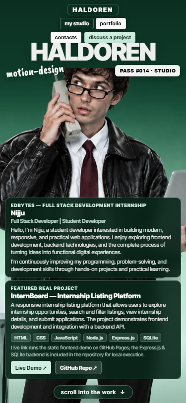
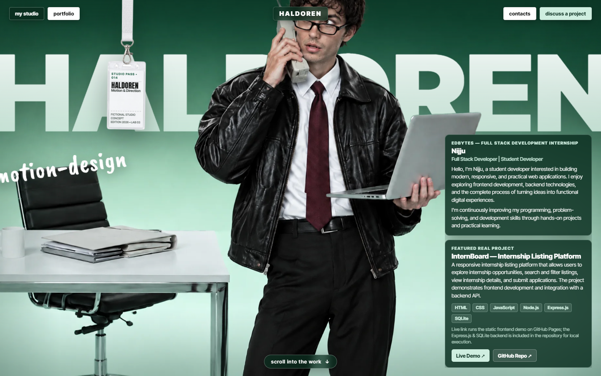
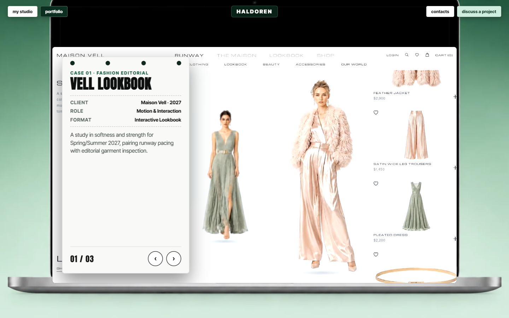

# EdBytes Full Stack Development Internship

> **Repository Navigation:**
> - **Milestone 2 (Motion Design Portfolio):** Detailed below (root `index.html`).
> - **Milestone 3 (TASKFLOW — Personal Task List):** Dedicated directory [`milestone-3-task-list/`](milestone-3-task-list/) | [Milestone 3 README](milestone-3-task-list/README.md) | [Milestone 3 Mentor Submission Report](milestone-3-task-list/SUBMISSION.md) | [Live Milestone 3 App](https://nijjukrr.github.io/EDBYTES/milestone-3-task-list/)

---

# Haldoren — Motion Design Portfolio (EdBytes Milestone 2)

## 1. Project Name
**Haldoren — Motion Design Portfolio** (built for **Nijju** — Full Stack Developer | Student Developer)

## 2. EdBytes Internship Milestone
- **Program:** EdBytes — Full Stack Development Internship
- **Milestone:** Milestone 2 — Task FSD-01 (`beginner-20261028`): *Your First Responsive Portfolio Page*

## 3. Project Overview
This project combines the official EdBytes Milestone 2 beginner portfolio requirements (a personal introduction for Nijju and a featured real project card for **InternBoard**) with the **Haldoren — Laptop Dive** interactive fixed-viewport motion-design experience inside a single, dependency-free `index.html`.

All CSS and JavaScript live inline inside `index.html`. An untouched copy of the original EdBytes starter pack is preserved separately inside `starter-backup/`.

## 4. Design Concept
The experience opens in a deep-green photographic studio (`#0b2f20` -> `#14503a` -> `#9fd8bf`) featuring a layered composition:
- Photographic studio backdrop and exact transparent subject cutout (`cutout`) sandwiching a giant SVG `HALDOREN` wordmark behind the subject.
- Handwritten `motion-design` script (`Caveat Brush`) and an interactive swinging lanyard studio pass (`HALDOREN — Fictional Studio Concept`).
- Fixed crisp white navigation tags (`my studio`, `portfolio`, `contacts`, `discuss a project`, center `HALDOREN`) and a visible **Developer Portfolio Dock** presenting Nijju's real About introduction and the **InternBoard** featured project without hiding them behind document scroll or locked modals.
- Triggering the portfolio dive (scroll wheel down, swipe up, `ArrowDown`, `PageDown`, `Space`, or `portfolio` button) plays a preloaded Blob transition video (~1.7s with a smooth playback-rate curve) into a front-facing silver laptop presenting three video case studies inside a punched-paper ticket interface (`Anton`), plus an animated return to the studio scene.

## 5. Main Features
- **Single-File Architecture:** Zero external frameworks, zero build step, inline `<style>` and inline `<script>` in `index.html`.
- **Real Owner & Project Clarity:** Clearly presents **Nijju**'s introduction and the **InternBoard — Internship Listing Platform** card (with technologies, GitHub link, live static demo link, and backend distinction) separately from the fictional Haldoren creative direction prop.
- **Logical `1440 × 810` Responsive Frame:** Scales cleanly across desktop viewports (`1024px`–`1920px`) and switches below `820px` to a mobile composition (`360px`–`820px`) with safe-area padding and zero horizontal overflow.
- **Cinematic Dive & Case Cycling:** Supports wheel, touch swipe, keyboard (`ArrowDown`, `ArrowUp`, `ArrowLeft`, `ArrowRight`, `PageDown`, `PageUp`, `Space`, `Escape`), and button controls with a transition busy-state guard and single-active-video playback enforcement.
- **Accessibility & Resilience:** Honors `prefers-reduced-motion: reduce`, includes `:focus-visible` outlines and modal focus restoration, and falls back gracefully if external images or videos are blocked or autoplay is restricted.

## 6. Technology Stack
- **Markup:** Semantic HTML5 (`index.html`)
- **Styling:** Inline CSS3 (Custom Properties, CSS Transforms, Grid/Flexbox, `env(safe-area-inset-*)`, `@media (prefers-reduced-motion: reduce)`)
- **Interactivity & Motion:** Vanilla JavaScript (Web Animations API, `requestAnimationFrame`, Fetch/Blob preloading, HTML5 `<video>`, inline `<svg>`, Pointer/Touch/Wheel/Keyboard events)
- **Typography:** Google Fonts (`Inter Tight`, `Caveat Brush`, `Anton` with `display=swap`)

## 7. Asset Credits & Source References
- **Supplied Haldoren Studio Media:**
  - Hero plate, Case plate, Subject cutout, and Lanyard badge served via `https://images.higgs.ai/` wrapping the supplied CloudFront URLs (`https://d8j0ntlcm91z4.cloudfront.net/user_38xzZboKViGWJOttwIXH07lWA1P/...`).
  - Transition video served directly from the supplied CloudFront MP4 URL.
  - Case study previews (`vell-lookbook.mp4`, `vasari-vhs-hero.mp4`, `living-portrait-hero.mp4`) streamed from `https://pub-86dc5b5484314368ac5436a674b0d919.r2.dev/aaaf/`.
- **EdBytes Starter Pack:** Preserved untouched in `starter-backup/` under CC0 1.0 (`LICENSE.txt`).

## 8. How to Run Locally
No installation or build step is required.
1. Clone the repository:
   ```bash
   git clone https://github.com/nijjukrr/EDBYTES.git
   cd EDBYTES
   ```
2. Open `index.html` directly in a modern browser, or serve the folder over HTTP:
   ```bash
   python -m http.server 8080
   ```
   Then visit `http://localhost:8080/`.

## 9. GitHub Repository URL
https://github.com/nijjukrr/EDBYTES.git

## 10. Live Website URL
*Not yet verified on GitHub Pages — see deployment instructions in `SUBMISSION.md` or update this section once GitHub Pages finishes building.*

## 11. Desktop Screenshot


## 12. Mobile Screenshot


## 13. Hero Screenshot


## 14. Case Mode Screenshot


*(Additional mobile evidence: [docs/evidence/hero-mobile.png](docs/evidence/hero-mobile.png) and [docs/evidence/case-mobile.png](docs/evidence/case-mobile.png))*

## 15. Responsive Test Results
Tested in headless Google Chrome across all 10 viewport sizes in both Hero and Case modes:
- **Narrow / Mobile & Tablet (`<= 820px`):** `360×740`, `375×812`, `390×844`, `430×932`, `768×1024`, `820×1180` — 0 horizontal overflow, unclipped navigation and mobile ticket card, visible laptop screen, and readable About & InternBoard cards.
- **Wide / Desktop (`> 820px`):** `1024×768`, `1280×720`, `1440×900`, `1920×1080` — 0 horizontal overflow, centered wordmark/subject composition, unclipped laptop bezel and punched-paper ticket, and accessible navigation.

## 16. Accessibility Notes
- Semantic landmarks (`<header>`, `<nav>`, `<section>`, `<article>`, `<aside>`, `role="dialog"` with `aria-modal="true"`).
- Keyboard navigation across modes, ticket buttons, badge trigger (`Enter`/`Space`), and `Escape` dismissal.
- Distinct `:focus-visible` outlines (`3px solid #cfeee0`).
- `prefers-reduced-motion: reduce` reveals the scene immediately (`navOpacity: 1`, `wordmarkOpacity: 1`), skips lanyard sway/transition video, and transitions to case mode in `~65ms`.

## 17. Known Limitations
- All photographic plates, transition clip, and case preview videos are loaded from external CDNs specified in the brief; offline viewing activates the CSS green-studio gradient and case-poster fallback instead of playing remote MP4 streams.
- Because the original preceding brief copy for the 3 Haldoren fictional case tickets was not included in the final session prompt, the ticket metadata (`VELL LOOKBOOK`, `VASARI VHS ARCHIVE`, `LIVING PORTRAIT`) was authored from inspecting the actual supplied MP4 video frames.
- The `InternBoard` Express.js + SQLite backend runs locally from its repository; the GitHub Pages demo link hosts the static frontend only.

## 18. What I Learned
- Measuring actual rendered image/video bounding boxes (`casePlate` black bezel and `badge` white insert coordinates) before positioning overlays prevents misalignment across scaled logical frames (`1440 × 810`).
- Implementing explicit media failure handlers, `prefers-reduced-motion` instant reveals, and safety timeouts on `busy` transition locks ensures an interactive fixed-viewport experience remains navigable even on slow or blocked networks.
