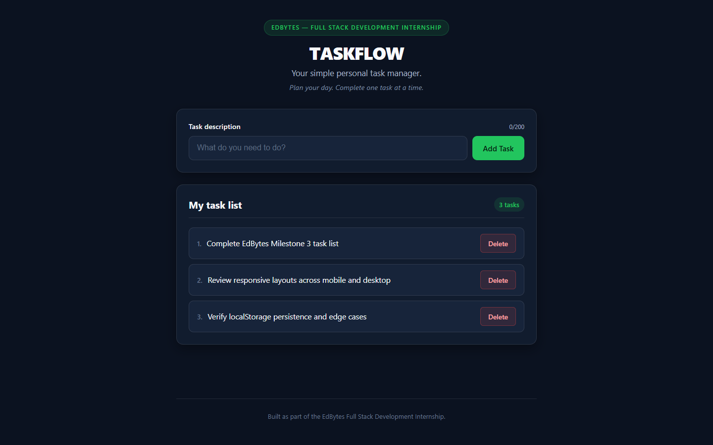
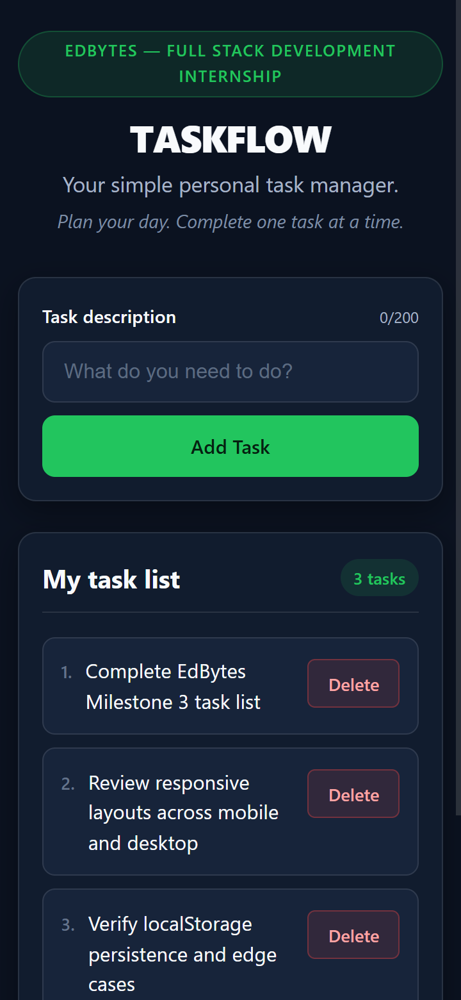

# TASKFLOW — Personal Task List
### EdBytes Full Stack Development Internship — Milestone 3 (Revision: beginner-20261028)

> *"Plan your day. Complete one task at a time."*

TASKFLOW is a clean, modern, accessible personal task management application built using semantic HTML5, modern CSS3, and vanilla JavaScript. It fulfills all four mandatory requirements of EdBytes Milestone 3: adding nonblank tasks, deleting individual tasks, persisting data across browser refreshes using `localStorage`, and restoring saved tasks seamlessly on page load.

---

## 1. Project Overview

TASKFLOW was developed as part of the **EdBytes Full Stack Development Internship (Milestone 3: A Small Task List)**. It provides a distraction-free, zero-dependency task manager that runs entirely in the browser without requiring a backend, database, or build pipeline.

### Key Highlights
- **100% Vanilla Web Technologies**: Plain HTML, CSS, and JavaScript.
- **Strict Data Security & XSS Prevention**: All user input is rendered using `textContent` (never `innerHTML`), preventing script injection.
- **Zero Data Loss**: State persists in browser `localStorage` using the official key `practice-tasks`.
- **Keyboard & Screen Reader Accessible**: Semantic HTML, distinct `:focus-visible` focus outlines, explicit form labels, and `role="status"` live region for messages.
- **Responsive Layout**: Fluid design verified from 360px mobile viewports up to 1440px desktop screens with zero horizontal overflow.

---

## 2. Features

- **Add Nonblank Tasks**: Validates input, trims whitespace, enforces a 200-character limit, clears the field, and updates the view immediately.
- **Delete Individual Tasks**: Each task has an isolated Delete button that removes only that specific item and updates the storage.
- **localStorage Persistence**: Uses the official `practice-tasks` key with resilient JSON parsing and graceful error handling.
- **Empty State**: Displays `"No tasks yet. Add your first task to get started."` when the list has no items.
- **Dynamic Task Counter**: Live counter accurately displaying `"0 tasks"`, `"1 task"`, `"2 tasks"`, etc.
- **Live Character Counter**: Displays remaining characters (`0/200`) and visually highlights input exceeding 200 characters.
- **Accessible Status Messages**: Live status feedback announcing `"Task added successfully."`, `"Task deleted."`, or `"Please enter a task."` via an `aria-live` region.

---

## 3. Technologies Used

- **HTML5**: Semantic tags (`<header>`, `<main>`, `<section>`, `<form>`, `<label>`, `<input>`, `<ul>`, `<li>`, `<footer>`).
- **CSS3**: CSS Custom Properties (variables), Flexbox layout, media queries, custom focus rings (`:focus-visible`), and smooth transitions.
- **JavaScript (ES6+)**: DOM manipulation (`replaceChildren`, `createElement`, `append`), event listeners (`onsubmit`, `onclick`, `input`), Array operations (`push`, `splice`, `filter`), and Web Storage API (`localStorage`).

---

## 4. How to Run Locally

Because TASKFLOW is a static web application, no build steps or dependencies are needed.

### Option A: Open directly in a browser
Double-click [index.html](file:///C:/Users/nijju/EDBYTES/milestone-3-task-list/index.html) or right-click and choose **Open with Google Chrome** (or Edge / Firefox / Safari).

### Option B: Serve via Python local server
Open your terminal in the `milestone-3-task-list` directory and run:
```bash
python -m http.server 8000
```
Then navigate to:
```
http://localhost:8000
```

### Option C: Serve via Node.js
```bash
npx serve .
```

---

## 5. Technical Implementation Details

### How Add Works
1. The user types task description into `<input id="text">` and presses **Enter** or clicks **Add Task**.
2. Form submission event (`submit`) is intercepted with `e.preventDefault()`.
3. The value is extracted and trimmed: `const text = input.value.trim();`.
4. **Validation**:
   - If empty or whitespace-only: displays `"Please enter a task."` and refocuses input.
   - If length > 200: displays `"Task must be 200 characters or fewer."` and halts.
5. The valid text is appended to the `tasks` array: `tasks.push(text)`.
6. `save()` commits the updated array to `localStorage`.
7. `render()` updates the DOM, re-evaluates the task counter, and removes the empty state.
8. The input field and character counter are reset, and an accessible success message `"Task added successfully."` is displayed.

### How Delete Works
1. Each task row contains its own `<button class="btn-delete">Delete</button>`.
2. When clicked, the click handler identifies the task's index and removes it from the array using `tasks.splice(index, 1)`.
3. `save()` writes the updated array to `localStorage`.
4. `render()` updates the DOM immediately and recalculates the counter.
5. An accessible confirmation message `"Task deleted."` is shown.

### How localStorage Persistence Works
- **Storage Key**: `practice-tasks`.
- **Loading on Startup**:
  ```javascript
  try {
    const raw = localStorage.getItem('practice-tasks');
    const saved = JSON.parse(raw || '[]');
    if (Array.isArray(saved)) {
      tasks = saved.filter(x => typeof x === 'string');
    }
  } catch (err) {
    console.warn('Could not parse saved tasks from localStorage:', err);
    tasks = [];
  }
  ```
- **Error Recovery**: If stored data is corrupted (invalid JSON) or localStorage is disabled, the app catches the error, initializes an empty list, and continues functioning without crashing.
- **Saving Changes**:
  ```javascript
  function save() {
    try {
      localStorage.setItem('practice-tasks', JSON.stringify(tasks));
      return true;
    } catch (err) {
      console.error('Failed to save tasks to localStorage:', err);
      showMessage('Storage unavailable. Changes may not persist after refresh.', 'warning');
      return false;
    }
  }
  ```

---

## 6. Form Validation & Edge Cases

| Scenario | User Input | Result / Behavior | Status Message |
| :--- | :--- | :--- | :--- |
| **Normal Task** | `"Complete EdBytes task"` | Task added, counter updates, input resets | `"Task added successfully."` |
| **Blank Input** | `""` | Rejected, no task added, input refocused | `"Please enter a task."` |
| **Whitespace Input** | `"     "` | Rejected after trimming, no task added | `"Please enter a task."` |
| **Exceeds Max Length** | `> 200` characters | Blocked by validator | `"Task must be 200 characters or fewer."` |
| **Special Characters / XSS** | `<script>alert(1)</script>` | Escaped safely via `textContent` | `"Task added successfully."` |
| **Page Refresh** | Any existing tasks | Reloaded from `practice-tasks` key | Restores all tasks |
| **Malformed Storage** | `MALFORMED{JSON:::` | Graceful recovery to `[]`, zero console crash | Restores empty state |

---

## 7. Responsive Design Verification

The interface was tested across major breakpoints:
- **360px** (Compact mobile — Galaxy S series)
- **375px / 390px / 430px** (iPhone SE, iPhone 14/15/16 Pro Max)
- **768px** (Tablet / iPad portrait)
- **1024px** (Tablet landscape / small laptop)
- **1280px / 1440px** (Full desktop)

### Mobile Optimizations
- Flexible flexbox layout collapses input and Add button on narrow screens.
- Strict word breaking (`overflow-wrap: anywhere; word-break: break-word;`) prevents horizontal overflow.
- Minimum touch target height of 48px on inputs and primary buttons.
- Full viewport width utilization with comfortable 0.85rem padding.

---

## 8. Visual Evidence & Screenshots

### Desktop View (1440 × 900)


### Mobile View (360 × 780)


---

## 9. What I Learned

During the development of Milestone 3, I deepened my understanding of defensive frontend programming:
1. **Separation of Concerns and Defensive DOM Rendering**: Using `element.textContent` instead of `innerHTML` is an absolute necessity when handling user input to guarantee complete protection against Cross-Site Scripting (XSS).
2. **Resilient Web Storage Handling**: Relying on `localStorage` requires wrapping both `JSON.parse()` and `localStorage.setItem()` in defensive `try/catch` blocks. Real-world browsers can encounter private browsing restrictions, quota limits, or corrupted values; handling these cases ensures the application remains usable under all circumstances.
3. **Accessibility as a Core Feature**: Implementing visible `:focus-visible` outlines, semantic labelling (`<label for="text">`), and live status regions (`role="status"`) transforms a basic task list into an accessible product for keyboard and screen-reader users.

---

## 10. Links

- **Repository**: [https://github.com/nijjukrr/EDBYTES](https://github.com/nijjukrr/EDBYTES)
- **Milestone 3 Folder**: [https://github.com/nijjukrr/EDBYTES/tree/main/milestone-3-task-list](https://github.com/nijjukrr/EDBYTES/tree/main/milestone-3-task-list)
- **Live GitHub Pages Application**: [https://nijjukrr.github.io/EDBYTES/milestone-3-task-list/](https://nijjukrr.github.io/EDBYTES/milestone-3-task-list/)
